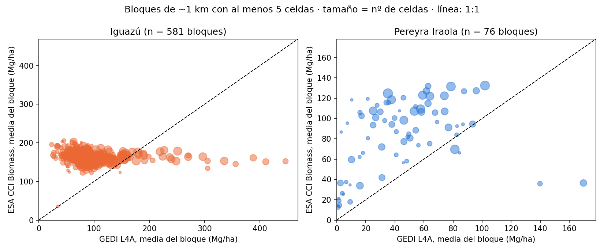

# GEDI L4A vs. ESA CCI Biomass — Iguazú y Pereyra Iraola

Comparación entre dos productos satelitales de biomasa aérea (Mg/ha) en el Parque Nacional Iguazú (+ Reserva Nacional) y la Reserva Pereyra Iraola, años 2019–2022.

> **Qué es y qué no es.** Es una comparación entre dos modelos satelitales, **sin parcelas de campo**. No valida ninguno de los dos productos: solo muestra si coinciden y cuánto.

## Resultados

| Sitio | Bloques de 1 km | GEDI L4A (Mg/ha) | CCI (Mg/ha) | CCI/GEDI | Spearman |
|---|---|---|---|---|---|
| Iguazú | 581 | 92,7 | 162,5 | 1,75 | −0,27 |
| Pereyra Iraola | 76 | 44,9 | 84,4 | 1,88 | 0,45 |

Por celdas de 100 m el cociente CCI/GEDI es 1,66 en Iguazú y 1,81 en Pereyra (`resumen_cci_gedi.csv`).

### Lectura
- **Iguazú:** CCI es casi plano (≈120–200 Mg/ha) mientras GEDI varía de 25 a 450, y la correlación espacial es nula o levemente negativa. Es lo esperable de un producto saturado, que no distingue entre zonas más y menos densas. Por eso el cociente de ≈1,7 **no** es evidencia de que GEDI subestime: en Iguazú CCI no sirve para juzgar el nivel absoluto.
- **Pereyra Iraola:** hay tendencia positiva moderada (mismas zonas densas y abiertas en ambos productos), pero CCI es siempre ≈1,9 veces más alto, probablemente por sobreestimación en un mosaico abierto y heterogéneo.
- Solo parcelas de campo pueden decidir el valor absoluto.

## Contenido
| Archivo | Qué es |
|---|---|
| `GEDI_vs_CCI_Biomass.ipynb` | Notebook de Colab + Earth Engine. Hay que poner tu proyecto en `GEE_PROJECT`. |
| `resumen_cci_gedi.csv`, `resumen_1km_cci_gedi.csv`, `medias_cci_por_area.csv` | Salidas resumidas |
| `figuras/` | Dispersión a 100 m y a 1 km |

## Método
- **GEDI L4A** (`LARSE/GEDI/GEDI04_A_002_MONTHLY`, `agbd`): huellas con `l4_quality_flag = 1`, `degrade_flag = 0` y sensibilidad ≥ 0,95.
- **ESA CCI Biomass** (`ESA/CCI/Above_Ground_Biomass/V6_0`, bandas `agb` y `agb_sd`, 100 m): el valor de la celda donde cae cada huella.
- Las huellas se extraen a 25 m, y las celdas de 100 m y los bloques de 1 km (con al menos 5 celdas) se arman en pandas. No se usa `reduceResolution`, que provocaba tiempos de espera excesivos.

No se publican las tablas por celda (incluyen coordenadas).

## Licencias
Código: MIT. Polígonos © colaboradores de OpenStreetMap ([ODbL](https://opendatacommons.org/licenses/odbl/)). GEDI: NASA/UMD. ESA CCI Biomass: ESA Climate Change Initiative.
