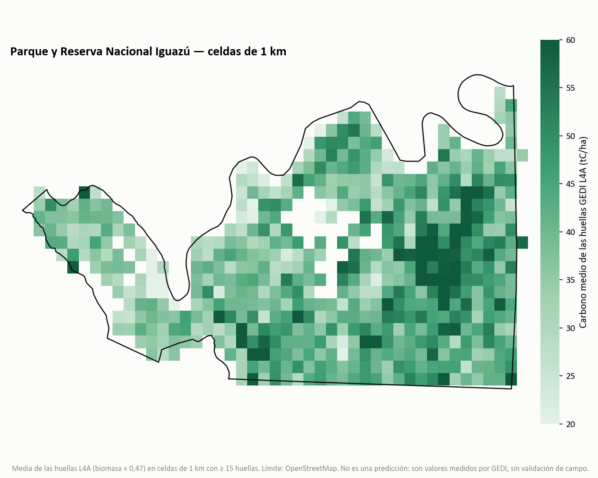

# Versión Iguazú — Parque Nacional Iguazú y Reserva Nacional (Misiones)

Mismo enfoque que la versión Pereyra, aplicado a la Selva Paranaense, **con las correcciones de la auditoría** (ver `../docs/CORRECCIONES_PEREYRA.md`): el resultado principal es lo que mide GEDI L4A, no un modelo entrenado sobre una ecuación sin validar.

> **Qué es y qué no es.** Es una estimación a partir de datos satelitales (lidar GEDI de la NASA), **sin validación con parcelas de campo**. Los valores absolutos de carbono son preliminares.

## Resultados (2019-04 a 2023-12, 58.177 ha, polígono OSM)

| Medida | Valor |
|---|---|
| Carbono aéreo, media de huellas GEDI L4A (AGBD × 0,47) | **41,5 tC/ha** (IC95 40,2–42,7; bootstrap por bloques de 2 km; 24.595 píxeles de 25 m) |
| GEDI L4B (grilla de 1 km, producto de la NASA) | 43,8 tC/ha |
| Altura del dosel, RH95 | mediana 18,3 m (p5–p95: 9,9–25,1 m) |
| Ecuación de Pereyra aplicada a RH95 | 59,7 tC/ha (solo para comparar; sobreestima frente a L4A en alturas bajas) |
| Mismo producto L4A, Pereyra vs. Iguazú | 11,5 vs. 41,5 tC/ha (×3,6) |
| Random Forest con Sentinel-2 | R² 0,08 (25 m) a 0,21 (1 km): **resultado negativo**; no se publica mapa ni stock total |

*Celdas de 1 km con al menos 15 huellas (585 celdas). Valores medidos por GEDI, sin validación de campo.*

### Lo que no se afirma
- Un stock total firme: falta el dato de campo que decida el valor absoluto.
- Que GEDI «subestime» o «sobreestime». La media de GEDI (≈ 41 tC/ha) es menor que las referencias disponibles (59,7 tC/ha, media regional del INBN2; ≈ 68 tC/ha, dos parcelas de tesis dentro del Parque; ≈ 99 tC/ha, siete parcelas del NO de Misiones; 125 tC/ha, bosque maduro del Bosque Atlántico), pero **la comparación no es pareja**: las dos parcelas del Parque se ubicaron a propósito en bosque de dosel cerrado y contaron árboles desde 5 cm de DAP (según sus autoras), mientras que la media de GEDI abarca todo el Parque, con zonas de estructura abierta. En un estudio de la región, el bosque de dosel abierto tuvo alrededor de un 50 % menos de carbono en biomasa que el cerrado (Zaninovich y Gatti, 2020). Por eso no hablo de «brecha»: solo la validación en campo puede decidirlo.
- Que el Random Forest sirva para mapear: con un objetivo independiente (GEDI) Sentinel-2 casi no explica la variación.

## Contenido
| Archivo | Qué es |
|---|---|
| `Carbono_Iguazu_GEDI_Sentinel2_RF.ipynb` | Pipeline completo en Colab + Earth Engine (GEDI, Sentinel-2, RF, validación espacial, Meta). Hay que poner tu proyecto en `GEE_PROJECT`. |
| `iguazu_resultados.py` | Reproduce las cifras de arriba desde la tabla, **sin Earth Engine**: `python iguazu_resultados.py` |
| `datos/huellas_iguazu_gedi.csv` | Tabla de 24.886 píxeles con huella GEDI: `lon, lat, RH95_m, AGBD_Mg_ha` |
| `datos/resumen_iguazu.csv` | Salida del script |
| `iguazu_osm.geojson` | Polígono del Parque + Reserva Nacional (© OpenStreetMap, ODbL) |
| `figuras/mapa_1km_L4A.png` | Mapa de la figura |

## Filtros de calidad GEDI
`quality_flag = 1`, `degrade_flag = 0`, sensibilidad ≥ 0,95, adquisición nocturna, |elevación GEDI − SRTM| ≤ 50 m, pendiente ≤ 20°.

## Qué falta
Parcelas de campo georreferenciadas dentro del Parque (INBN2, Subsecretaría de Ambiente de Misiones, Parques Nacionales). Hay pedidos de datos en curso; si tenés parcelas, escribime.

## Licencias
Código: MIT. Polígono © colaboradores de OpenStreetMap ([ODbL](https://opendatacommons.org/licenses/odbl/)). GEDI: NASA/UMD. Sentinel-2: Copernicus/ESA. Altura de dosel: Meta y WRI (Tolan et al., 2024).
