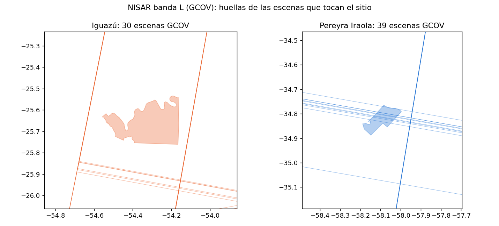
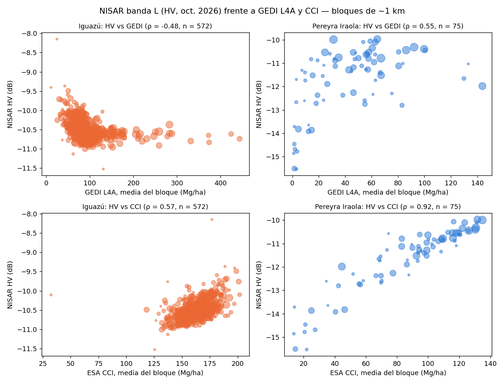

# NISAR (banda L) sobre Iguazú y Pereyra Iraola

Cobertura de NISAR y una primera prueba de retrodispersión (HV, HH) frente a GEDI L4A y ESA CCI, a 1 km.

> **Qué es y qué no es.** Una prueba exploratoria con **una escena por sitio** (octubre de 2026) de un producto **provisional**, comparada con GEDI de 2019–2023. No es una validación ni una estimación de biomasa.

## Cobertura (catálogo de ASF, productos GCOV)
| | Iguazú | Pereyra Iraola |
|---|---|---|
| Escenas | 30 | 39 (30 cubren todo el sitio) |
| Período | 19/6 a 22/10/2026 | 19/6 a 23/10/2026 |
| Trayectorias | 3 | 3 |
| Colección | `NISAR_L2_GCOV_PROVISIONAL_V1` | idem |

## Retrodispersión y relación con GEDI y CCI (bloques de ~1 km, ≥ 5 celdas)
| | Iguazú | Pereyra Iraola |
|---|---|---|
| Escena | camino 154 (22/10/2026) | camino 161 (23/10/2026) |
| HV, mediana (dB) | −11,3 | −14,8 |
| ρ de Spearman, HV vs GEDI L4A | −0,48 | 0,55 |
| ρ de Spearman, HV vs CCI | 0,57 | 0,92 |
| Bloques | 572 | 75 |

### Lectura
- **Iguazú:** casi todos los bloques caen en un rango estrecho de HV (≈ −11 a −9,5 dB) sin importar si GEDI marca 50 o 300 Mg/ha, y por encima de ≈ 100 Mg/ha la relación es plana. Es lo esperable de una señal de banda L saturada en bosque denso: el radar tampoco permite decidir el nivel absoluto de biomasa.
- **Pereyra Iraola:** HV sube con GEDI en valores bajos y luego se aplana; distingue zonas abiertas de arboladas.
- **CCI no es independiente del radar:** CCI incorpora datos SAR en su construcción (no verificado para la versión usada), así que su alta correlación con HV era esperable y no la confirma de forma independiente.
- Para fijar el valor absoluto hacen falta parcelas de campo o lidar.

## Salvedades
Una sola escena por sitio (octubre de 2026) frente a GEDI de 2019–2023; producto provisional de NISAR (revisar problemas conocidos en la guía de ASF); humedad del suelo y estacionalidad no se evaluaron.

## Contenido
| Archivo | Qué es |
|---|---|
| `nisar_cobertura.py` | Consulta el catálogo de ASF (sin descarga ni cuenta); genera `escenas_nisar_gcov.csv`, `resumen_nisar.csv` y el mapa de cobertura |
| `descargar_escena.py` | Descarga una escena por sitio con un token personal de NASA Earthdata (`nisar/env.txt`, con una línea `EARTHDATA_TOKEN=...`; no se versiona) |
| `nisar_hv.py` | Calcula HV y HH en las celdas de 100 m del análisis de `cci_biomass` y las compara a 1 km. Necesita `pares_cci_gedi.csv`, salida local del notebook de `cci_biomass` (tiene coordenadas, no se publica) |
| `resumen_nisar_hv.csv`, `resumen_nisar_vs_gedi_1km.csv` | Resultados resumidos |

Las escenas (6 a 7 GB cada una) no se incluyen: se bajan con `descargar_escena.py`.

Datos: NISAR (NASA-ISRO, distribuido por ASF DAAC), GEDI (NASA/UMD), ESA CCI Biomass. Código: MIT.
